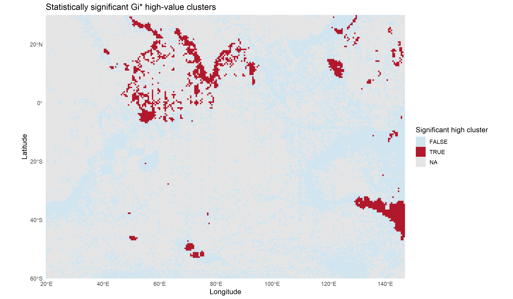
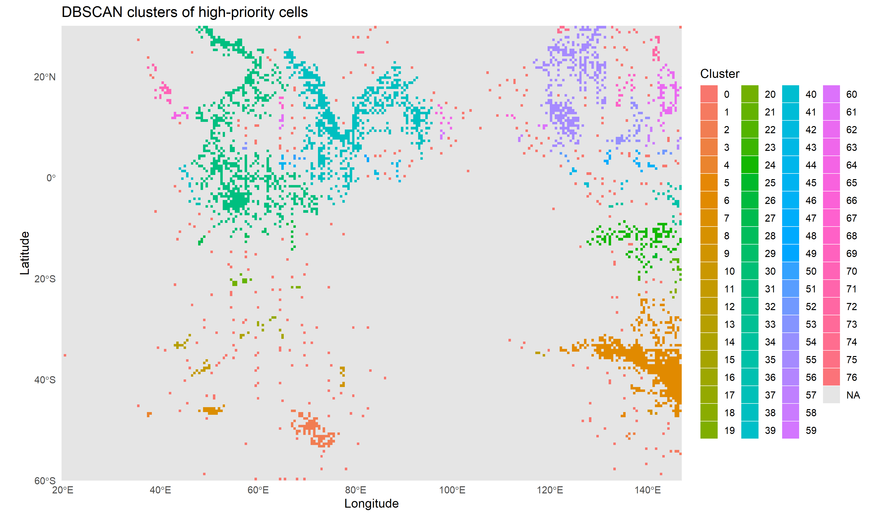

# Mapping Marine Pollution-Biodiversity Hotspots

An R-based geospatial analysis of observed marine pollution and marine
biodiversity patterns across the Indian Ocean. The project identifies cells
where high pollution and high observed species richness overlap, tests whether
those patterns are spatially clustered, groups connected priority cells into
regions, and evaluates seasonal persistence.

> **Interpretation:** The outputs identify observed pollution-biodiversity
> co-occurrence. They do not prove that pollution caused changes in
> biodiversity.

## Research question

Where do relatively high marine pollution values overlap with high observed
marine biodiversity, and which areas should be prioritised for further
monitoring and conservation investigation?

## What is novel about this workflow?

Many studies map pollution and biodiversity separately or compare two maps
visually. This project combines both layers in a common spatial grid and then
refines the result through several complementary analyses:

1. A transparent effective-hotspot rule identifies cells where both layers are
   high.
2. A multiplicative score ranks the strength of the joint signal.
3. Moran's I tests whether similar scores are spatially grouped overall.
4. Getis-Ord Gi* identifies local high-value neighbourhoods.
5. DBSCAN groups nearby priority cells into operational geographic regions.
6. Seasonal analysis classifies cells as persistent or transient.
7. Sensitivity analysis tests different thresholds and grid resolutions.

This converts separate observations into a reproducible decision-support
workflow for identifying candidate monitoring and intervention regions.

## Current data configuration

The current generated outputs use:

```r
cfg$paths$microplastics_raw =
  "data/raw/noaa_oisst_marine_heatwaves.csv"
```

This configured file is a preprocessed, cell-level pollution/concentration
layer with `cell_id`, coordinates, and `concentration`. It does **not** retain
a sampling timestamp. Therefore, the current seasonal analysis uses
season-specific biodiversity observations against an undated pollution layer;
it is not a fully season-specific pollution time series.

The dated NOAA marine-microplastics export is also present at
`data/raw/noaa_marine_microplastics.csv`. It contains `Sample Date`, but it is
not the input used for the current result tables and figures. To analyse
season-specific microplastic observations, change `cfg$paths$microplastics_raw`
to that file and rerun the dependent pipeline steps.

The biodiversity input is the OBIS occurrence export:

```text
data/raw/obis_indian_ocean_occurrences.csv
```

## Study area and main settings

| Setting | Value |
|---|---|
| Geographic extent | 20°E–147°E, 60°S–30°N |
| Coordinate reference system | WGS 84 / EPSG:4326 |
| Main grid | 0.5° × 0.5° |
| Grid cells | 45,720 |
| Main hotspot threshold | 80th percentile |
| Threshold domain | `all_observed` |
| DBSCAN neighbourhood | 150 km |
| DBSCAN minimum points | 3 |

For each cell, the pipeline calculates pollution metrics, species richness,
taxonomic-group richness, and biodiversity occurrence count. Biodiversity
ranking uses the number of distinct scientific names (`species_richness`);
the raw occurrence count is retained as sampling-effort information.

The combined score is:

```text
hotspot_score = normalized_pollution_rank × normalized_biodiversity_rank
```

An **effective hotspot** requires both `pollution_hotspot` and
`biodiversity_hotspot` to be true. Missing observations remain `NA`; they are
not converted to zero.

## Analysis pipeline

```text
Input data
  → clean coordinates, values, and duplicate records
  → create the common spatial grid
  → assign observations to cells
  → aggregate pollution and biodiversity metrics
  → calculate hotspot scores and effective hotspots
  → run Moran's I, Getis-Ord Gi*, and DBSCAN
  → evaluate seasonal persistence
  → test thresholds and grid resolutions
  → export maps, tables, and reports
```

### Spatial methods

- **Moran's I** asks whether similar hotspot scores are grouped across the
  study area.
- **Getis-Ord Gi*** identifies cells surrounded by statistically high values.
- **DBSCAN** groups nearby high-priority cells into connected regions without
  requiring a preselected number of clusters. Cluster `0` represents noise.

These methods answer different questions: global spatial structure, local
statistical significance, and geographic density grouping.

### Seasonal analysis

The biodiversity records are assigned to four practical oceanographic seasons:

| Code | Months | Interpretation |
|---|---|---|
| S1 | December–February | Northeast monsoon |
| S2 | March–May | Spring intermonsoon |
| S3 | June–September | Southwest monsoon and upwelling |
| S4 | October–November | Fall intermonsoon transition |

Cells effective in at least three seasons are classified as persistent;
cells effective in one or two seasons are classified as transient. Because the
current pollution input is undated, these classifications describe seasonal
biodiversity–pollution co-occurrence using the available pollution layer.

## Verified current results

### Annual analysis

| Result | Value |
|---|---:|
| Grid cells | 45,720 |
| Valid paired cells | 15,533 |
| Annual effective hotspots | **745** |
| Moran's I | **0.551** |
| Moran's I p-value | Approximately 0 |
| Gi* significant high-value cells | **1,761** |
| DBSCAN clusters | **76** |
| DBSCAN clustered cells | **2,784** |
| DBSCAN noise cells | **323** |

The positive Moran's I indicates that similar hotspot scores are spatially
clustered rather than randomly distributed. Gi* then identifies statistically
supported local high-value cells, while DBSCAN converts connected priority
cells into larger geographic groups.

### Seasonal stability

| Classification | Cells | Meaning |
|---|---:|---|
| Persistent hotspot | **63** | Effective in at least 3 seasons |
| Transient hotspot | **323** | Effective in 1–2 seasons |
| Sampled non-hotspot | **11,365** | Seasonal data exists, but both layers do not exceed thresholds together |
| Unsampled | **33,969** | No valid seasonal hotspot score |

The annual count and seasonal count are not directly interchangeable. Annual
analysis combines observations across the full record, whereas seasonal
analysis evaluates each season separately. A cell can therefore be an annual
hotspot without passing the stricter seasonal test in any one season.

### Sensitivity analysis

| Grid | Threshold | Valid paired cells | Effective hotspots |
|---:|---:|---:|---:|
| 0.5° | 70th percentile | 15,533 | 1,473 |
| 0.5° | 80th percentile | 15,533 | 745 |
| 0.5° | 90th percentile | 15,533 | 187 |
| 1.0° | 70th percentile | 7,024 | 697 |
| 1.0° | 80th percentile | 7,024 | 381 |
| 1.0° | 90th percentile | 7,024 | 66 |

The number of hotspots decreases as the threshold becomes stricter, and the
coarser grid merges nearby cells. The general pattern is directionally
consistent, but exact geographic overlap should be calculated separately if
formal spatial robustness percentages are required.

## Running the project

Open the project file in RStudio:

```text
marine-microplastic-biodiversity.Rproj
```

Install packages once:

```r
source("scripts/setup_packages.R")
```

Run the complete pipeline from the project root:

```r
source("scripts/run_pipeline.R")
```

From PowerShell:

```powershell
Set-Location "C:\path\to\Mapping Marine Microplastic Pollution & Biodiversity Hotspots"
& "C:\Program Files\R\R-4.6.1\bin\Rscript.exe" scripts/run_pipeline.R
```

Run the Shiny dashboard:

```powershell
& "C:\Program Files\R\R-4.6.1\bin\Rscript.exe" -e "shiny::runApp('R/12_shiny_dashboard.R', launch.browser = TRUE)"
```

Run the core tests:

```powershell
& "C:\Program Files\R\R-4.6.1\bin\Rscript.exe" tests/test_core.R
```

The sensitivity analysis is the longest step because it repeats spatial
aggregation for six grid-resolution and threshold combinations.

## Project structure

```text
config.R                         central settings
R/utils.R                        reusable cleaning and spatial functions
R/01_download_data.R             provenance and data dictionary
R/02_clean_microplastics.R       pollution cleaning
R/03_clean_biodiversity.R        biodiversity cleaning
R/04_create_grid.R               grid construction
R/05_spatial_join.R               point-in-polygon assignment
R/06_pollution_analysis.R         pollution summaries
R/07_biodiversity_analysis.R      biodiversity summaries
R/08_hotspot_analysis.R           hotspot scoring
R/09_spatial_statistics.R         Moran's I, Gi*, and DBSCAN
R/10_sensitivity_analysis.R       threshold and resolution checks
R/11_visualization.R              maps and figures
R/12_shiny_dashboard.R            interactive dashboard
scripts/run_pipeline.R            runs steps 1–11
tests/                             validation scripts
data/raw/                          source CSV files
data/interim/                      cleaned data and spatial joins
data/processed/                    analysis-ready outputs
outputs/maps/                      generated maps
outputs/figures/                   generated figures
outputs/tables/                    generated result tables
```

## Main outputs

- `outputs/maps/effective_hotspots.png`
- `outputs/maps/gi_star_high_clusters.png`
- `outputs/maps/seasonal_hotspots.png`
- `outputs/maps/temporal_stability.png`
- `outputs/tables/grid_analysis_summary.csv`
- `outputs/tables/moran_results.csv`
- `outputs/tables/getis_ord_results.csv`
- `outputs/tables/dbscan_results.csv`
- `outputs/tables/temporal_stability_summary.csv`
- `outputs/tables/sensitivity_analysis.csv`

## Key spatial results

### Getis-Ord Gi* significant high-value clusters

Gi* highlights cells that have high hotspot values and are surrounded by other
high-value cells. Red areas are statistically significant local high-value
clusters; they are not simply isolated high-scoring cells.



### DBSCAN priority clusters

DBSCAN groups nearby high-priority cells into geographic regions using the
configured 150 km neighbourhood and minimum density of three cells. Each
colour represents a different cluster label; the colours are categorical and
do not indicate pollution magnitude or priority ranking. Cluster `0` denotes
noise or isolated priority cells.



## Limitations

- The study extent is a rectangular bounding box, not a land-masked ocean
  polygon.
- Sampling is uneven, so high occurrence counts may partly reflect sampling
  effort.
- The current configured pollution layer is undated and should not be used to
  claim fully temporal pollution dynamics.
- Grid resolution, percentile thresholds, measurement methods, and source
  coverage affect the results.
- Unsampled cells indicate insufficient data, not confirmed clean or
  low-biodiversity areas.
- The analysis identifies spatial association and co-occurrence, not
  causation.
